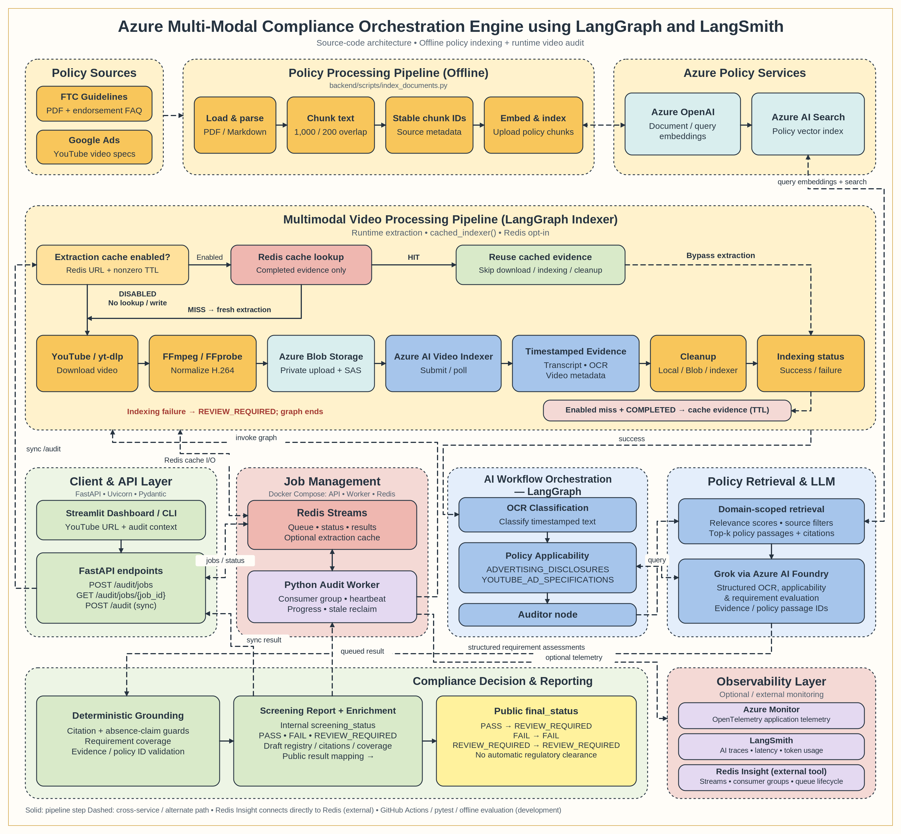
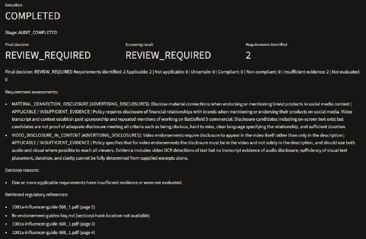
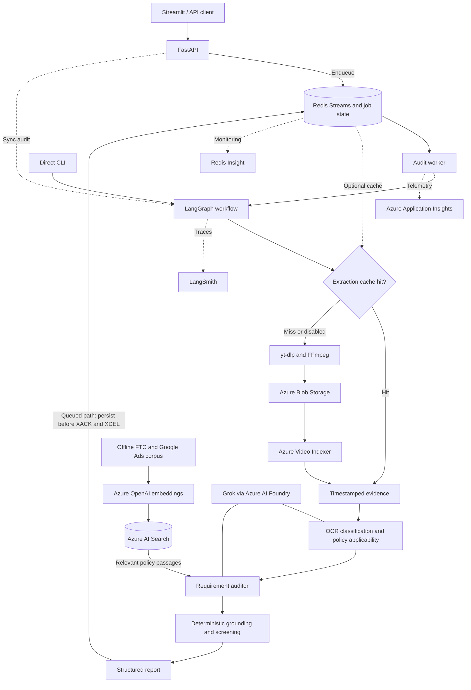
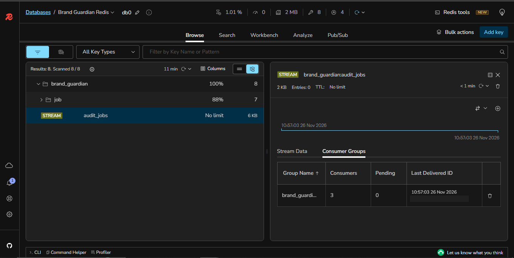
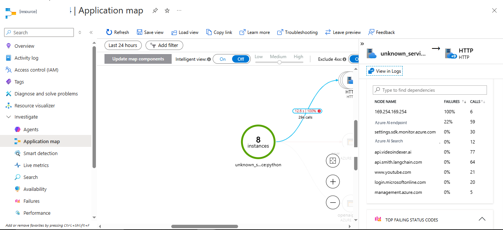

# Brand Guardian

Azure multimodal AI compliance engine.

     

Brand Guardian extracts timestamped transcripts and on-screen text from YouTube videos, retrieves relevant regulatory guidance, and generates structured screening reports with evidence and citations. Long-running audits execute asynchronously using FastAPI, Redis Streams and LangGraph. Grok performs policy reasoning, with deterministic reference validation and human-review safeguards.

**Status:** locally deployed with live Azure integrations. US-focused policy corpus; not a regulatory clearance or legal advice system.

[Architecture](#architecture) · [Quick start](#quick-start) · [API](#api) · [Validation](#validation) · [Documentation](#documentation)
## System Architecture

<p align="center">
  
</p>

## Overview



[Recorded narrated walkthrough](docs/demo.mp4) — illustrates the system and previously recorded results; not a live screen recording.

### Capabilities

- **Multimodal ingestion:** yt-dlp, FFmpeg/FFprobe, Azure Blob Storage and Azure Video Indexer for transcript and OCR extraction.
- **Regulatory RAG:** offline policy indexing, Azure OpenAI embeddings, Azure AI Search and domain-scoped retrieval.
- **AI workflow:** conditional LangGraph orchestration, Grok via Azure AI Foundry, and Pydantic structured outputs.
- **Grounding:** timestamped evidence IDs, policy passage IDs, disclosure-prioritized context selection and conservative review decisions.
- **Asynchronous processing:** Redis Streams consumer groups, job status, heartbeat, stale-message reclaim and optional extraction caching.
- **Observability:** LangSmith traces, Redis Insight monitoring and Azure Application Insights dependency telemetry.

## Architecture



The diagram shows the successful extraction path. Indexing failures bypass downstream evaluation and require review. Offline policy indexing is independent of runtime video extraction. The direct CLI and synchronous API paths bypass the asynchronous queue. See [Architecture](docs/ARCHITECTURE.md) and [Implementation reference](docs/IMPLEMENTATION.md) for detailed diagrams, component paths, decision branches and trade-offs.

## Quick start

### Prerequisites

- Git, Docker Desktop with Compose, and uv; Python 3.14.3 for the local environment.
- Configured Azure Blob Storage, Video Indexer, Azure AI Foundry Grok deployment, Azure OpenAI embeddings and Azure AI Search.
- Authorized videos and reviewed policy source documents. LangSmith and Application Insights are optional integrations. Cloud usage may incur charges.

### Installation (Windows CMD)

Run from the repository root:

```cmd
uv python install 3.14.3
uv sync --frozen
```

For a fresh setup only:

```cmd
copy .env.example .env
notepad .env
```

Populate the template with your own configuration. Never overwrite an existing working `.env` or commit credentials. See [Operations](docs/OPERATIONS.md) for environment variables, media dependencies and monitoring configuration.

### Policy indexing

Place authorized policy files in `backend/data/` as described in [Policy sources](docs/POLICY_SOURCES.md). With a compatible dedicated search index configured, run the offline indexing script once:

```cmd
uv run python -m backend.scripts.index_documents
```

Skip this step if the compatible policy index already exists. Review source cleanup behavior before indexing against a shared index.

### Run

```cmd
docker compose up -d --build
docker compose ps
curl http://127.0.0.1:8000/health/ready
```

Start the dashboard in a second terminal:

```cmd
uv run streamlit run dashboard.py --server.address 127.0.0.1
```

| Interface | Address |
| --- | --- |
| Dashboard | http://127.0.0.1:8501 |
| FastAPI / Swagger UI | http://127.0.0.1:8000/docs |
| Readiness | http://127.0.0.1:8000/health/ready |
| Redis Insight (optional separate container) | http://127.0.0.1:5540 |
| LangSmith (optional) | https://smith.langchain.com/ |

Submit an authorized video URL and audit context in the dashboard, then poll or resume the returned job ID. Readiness verifies configuration and Redis connectivity, not every cloud dependency.

## API

Audit endpoints require `X-API-Key`. The live `/openapi.json` is the runtime contract.

| Method | Path | Description |
| --- | --- | --- |
| POST | `/audit/jobs` | Queue an audit (HTTP 202) |
| GET | `/audit/jobs/{job_id}` | Retrieve status, stage and result |
| POST | `/audit` | Synchronous compatibility endpoint |
| GET | `/health` | Liveness |
| GET | `/health/ready` | Readiness |

Example request body:

```json
{
  "video_url": "https://www.youtube.com/watch?v=F1Lt8isKPlk",
  "commercial_relationship": "PAID_SPONSORSHIP",
  "youtube_placement": "ORGANIC_UPLOAD",
  "ad_format": "UNKNOWN",
  "jurisdiction": "US"
}
```

The example context is a recorded test assumption, not independently verified campaign metadata. A completed job can still return `REVIEW_REQUIRED`. Public regulatory `PASS` is restricted pending verified policy coverage. See [API reference](docs/API.md) for the report contract and error handling.

## Validation

```cmd
uv run pytest -v
uv run python -m backend.evaluation.smoke_v21
```

Recorded V2.2 Windows results: **105 passing automated tests** (18 deprecation warnings, 72.93 seconds) and **4/4 synthetic decision checks**. The CI workflow is configured; a remote CI pass is not asserted.

### Live audit observations

The same 304.9-second US sponsorship test scenario was executed three times:

| Metric | V2.1 | V2.2 first | V2.2 latest |
| --- | ---: | ---: | ---: |
| Elapsed time (s) | 696.016 | 498.671 | 508.931 |
| Retained citation locations | 0 | 4 | 5 |
| Detected disclosure candidates supplied | Not reported | 6/6 | 6/6 |
| Applicable requirements | 0 | 2 | 3 |
| Conclusive assessments | 0 | 0 | 0 |
| Final screening decision | REVIEW_REQUIRED | REVIEW_REQUIRED | REVIEW_REQUIRED |

The first V2.2 execution was 28.4% shorter than the V2.1 observation. These are uncontrolled runs; extraction caching was disabled in both V2.2 runs. Candidate preservation is not disclosure recall, and citation grounding is not legal correctness. See [Validation](docs/VALIDATION.md) for coverage, stage timings and limitations.

## Observability

| Tool | Demonstrated behavior |
| --- | --- |
| LangSmith | Workflow/node traces, Grok model identity, latency and token usage; 94% prompt-cache hit rate in one model call |
| Redis Insight | Stream delivery, pending count 1 → 0 and matching completed job result |
| Azure Application Insights | Live dependency telemetry and Application Map; Azure AI endpoint failures remain under investigation |

<details>
<summary>Redis and Azure monitoring screenshots</summary>





</details>

Monitoring evidence demonstrates instrumentation, not guaranteed availability. LLM prompt caching is distinct from the optional Redis extraction cache. For diagnostics and KQL queries, see [Operations](docs/OPERATIONS.md).

## Repository layout

```text
backend/
  scripts/       Offline policy indexing
  policies/      Draft requirement registry
  evaluation/    Evaluation utilities and synthetic cases
  src/
    api/         REST API and telemetry
    graph/       LangGraph workflow and state
    ingestion/   Video processing
    retrieval/   Embeddings and vector search
    auditing/    Evidence, grounding and screening
    services/    Cloud integrations and Redis queue
    worker.py    Background job processing
tests/           Automated regression suite
infra/           Infrastructure configuration
docs/            Technical documentation and demo assets
dashboard.py    Streamlit UI
docker-compose.yml
pyproject.toml
```

## Documentation

| Document | Contents |
| --- | --- |
| [Architecture](docs/ARCHITECTURE.md) | Components, workflow and job sequence |
| [Implementation reference](docs/IMPLEMENTATION.md) | Detailed architecture, configuration and report contract |
| [API](docs/API.md) | Endpoints, schemas and errors |
| [Operations](docs/OPERATIONS.md) | Deployment, observability and troubleshooting |
| [Validation](docs/VALIDATION.md) | Tests, live audit results and performance |
| [Policy sources](docs/POLICY_SOURCES.md) | Corpus setup and governance |
| [Demonstration](docs/DEMONSTRATION.md) | Walkthrough and screenshot guide |
| [Release notes](docs/RELEASE_NOTES.md) | V2.2 scope and changes |


