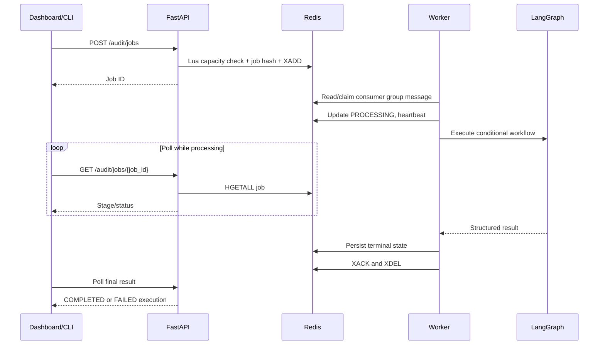

# Architecture and engineering decisions

## Runtime components

| Component | Source | Responsibility |
|---|---|---|
| API | `backend/src/api/server.py`, `main.py` | Validated requests, authentication, job submission/polling, readiness |
| Queue | `backend/src/services/audit_job_queue.py` | Lua enqueue capacity check, Redis Streams and job hashes |
| Worker | `backend/src/worker.py` | Claim jobs, heartbeat, execute graph, persist terminal state, acknowledge and delete |
| Graph | `backend/src/graph/workflow.py`, `states.py`, `nodes.py` | Conditional workflow, typed state, extraction, classification, applicability, audit |
| Ingestion | `backend/src/ingestion/`, `backend/src/services/` | YouTube ingestion, media conversion, Blob Storage and Video Indexer |
| Retrieval | `backend/src/retrieval/`, `backend/scripts/index_documents.py` | Embeddings, policy indexing, relevance filtering and provenance |
| Grounding | `backend/src/auditing/evidence.py`, `passages.py`, `policy_scope.py` | Evidence catalog, policy IDs, source-domain and jurisdiction checks |
| Screening | `backend/src/auditing/screening.py`, `public_report.py` | Conservative outcome and public response shaping |
| Operations | `extraction_cache.py`, `progress.py`, API tracing/telemetry modules | Optional extraction cache, stage metrics and instrumentation |
| UI | `dashboard.py`, `audit_client.py`, `submit_audit.py`, `check_audit.py` | Submit, monitor, resume and export |

## Job lifecycle

Stream: `brand_guardian:audit_jobs`; group: `brand_guardian:audit_workers`; job prefix: `brand_guardian:job:`. Job records have a seven-day TTL. Heartbeats and stale-message reclaim mitigate worker crashes; without fencing/idempotent external calls, duplicate execution remains possible. Queue acknowledgement follows terminal-state persistence.

## Graph and grounding

`indexer → route_after_indexing → ocr_classifier → policy_applicability → auditor`. Failed indexing ends downstream execution. Cache hits can skip extraction; classification and policy reasoning still execute. The auditor applies domain/jurisdiction scope, retrieves policy passages and builds a bounded evidence catalog. Disclosure-related keywords and adjacent same-modality records receive priority; raw OCR candidates are recovered if cleaning removed them. Evidence IDs resolve only to supplied catalog records. Policy passage IDs resolve to retrieved text and source location with domain checks. Legacy quote validation also exists. Absence cannot be established from incomplete extraction.

## Design trade-offs

- Graph instead of unconstrained agent loop: explicit transitions and testable nodes.
- Queue instead of blocking HTTP: long-running video audits can be polled independently.
- RAG instead of relying on model memory: source-backed policy context, but retrieval recall remains unknown.
- Deterministic provenance instead of generated quotes: reduces fabricated references, not incorrect reasoning.
- Human review instead of automatic clearance: incomplete evidence or policy coverage is not treated as approval.
- URL-based extraction caching saves repeated extraction work, but can be stale after video edits; TTL zero disables it.

Technical asset checks are an offline helper, not a verified original-video inspection stage. The draft registry is not an enforced exhaustive checklist. Domain filtering is client-side source-family filtering, not a claim of server-side metadata filtering.

## Cross-cutting observability

LangSmith traces LangGraph and LLM calls; Redis Insight inspects queue state and consumer groups; Azure Monitor/OpenTelemetry sends configured application telemetry to Application Insights. All three surfaces have been observed live. Application Insights dependency failures remain under investigation. These tools observe execution rather than determine compliance. See the README for the corrected complete diagrams.
