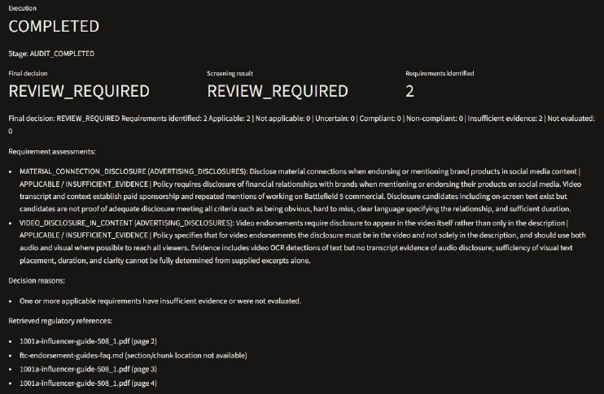
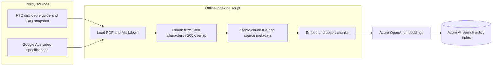
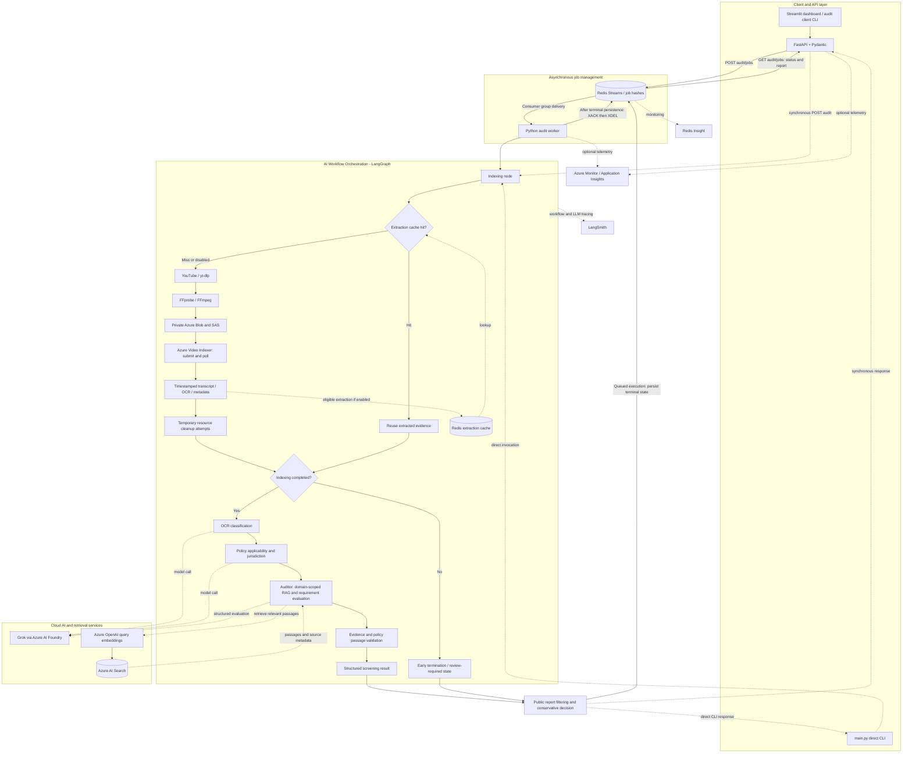
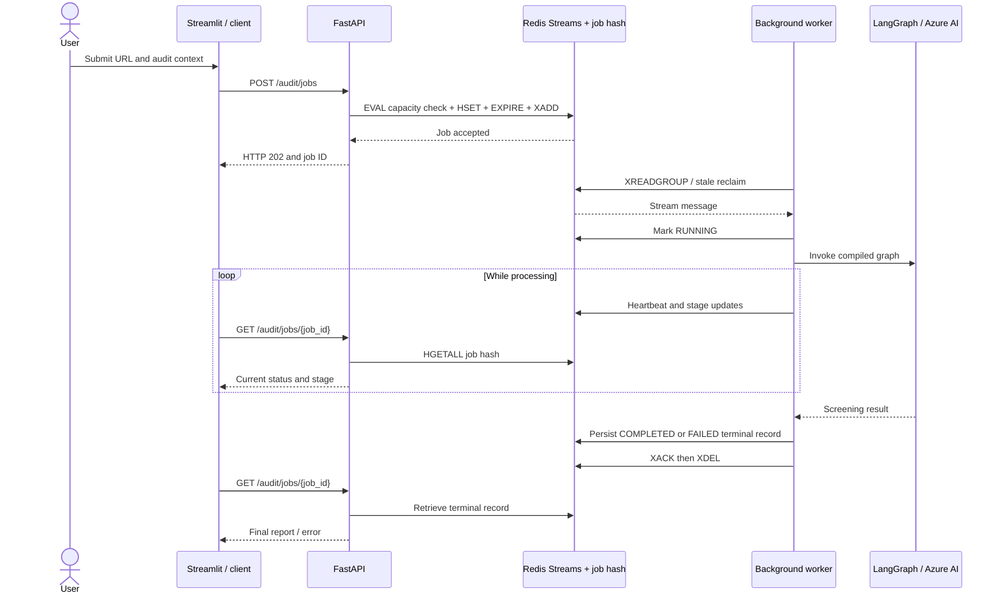
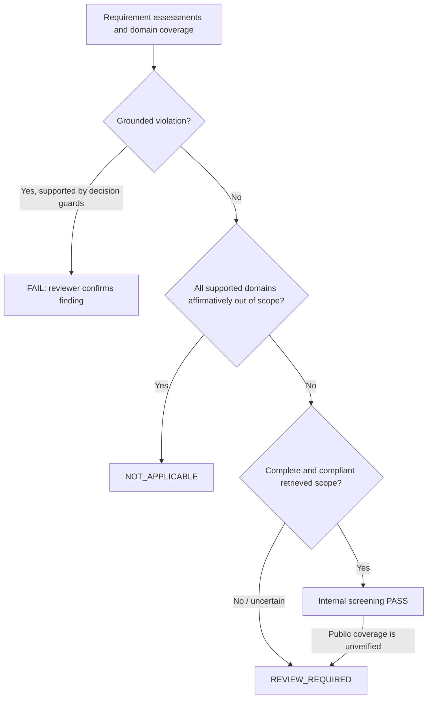
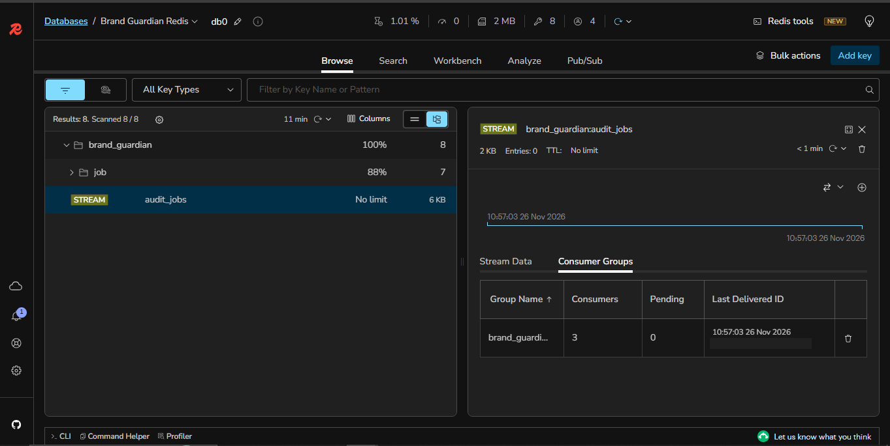
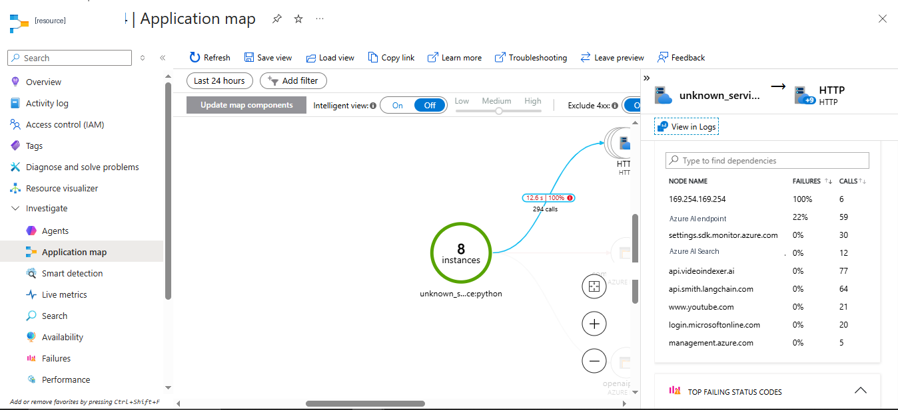

# Brand Guardian | Azure Multimodal AI Compliance Screening Engine

**LangGraph orchestration · Azure Video Indexer · Regulatory RAG · Redis Streams · LangSmith · Azure Application Insights**

        

Brand Guardian is an end-to-end AI engineering project that converts YouTube videos into structured, evidence-grounded advertising compliance screening reports. It combines timestamped speech transcripts and on-screen text, regulatory retrieval-augmented generation (RAG), stateful LangGraph workflows, Grok reasoning and deterministic evidence validation. FastAPI and Redis Streams decouple long-running Azure video processing from client requests, while LangSmith, Redis Insight and Azure Application Insights expose AI execution, queue behavior and cloud dependency telemetry.

> **Scope:** A portfolio-grade screening assistant for human reviewers, not legal advice, certified compliance, or autonomous regulatory clearance. The disclosure corpus is US-focused and the policy registry remains unreviewed.

[Architecture](#system-architecture) · [Quick start](#quick-start) · [API](#api-reference) · [Observability](#observability-and-monitoring) · [Validation](#validation-and-benchmarks) · [Limitations](#limitations-and-production-readiness)

[Watch the narrated project walkthrough](demo.mp4)



## Engineering results at a glance

| Demonstrated capability | Recorded result |
| --- | --- |
| Automated regression suite | **105/105 passed** on Windows; 72.93 seconds |
| Synthetic decision safeguards | **4/4 passed** |
| Regulatory citation provenance | **0 → 4 → 5** retained source locations across three audits of the same US test scenario |
| Disclosure candidate preservation | **6/6** detected candidates supplied in both V2.2 US runs |
| Asynchronous job lifecycle | Redis pending count **1 → 0**, stream entries **1 → 0**, matching completed job report |
| LLM observability | Live LangSmith workflow traces, Grok model identity, latency, token and prompt-cache telemetry |
| Cloud observability | Live Azure Application Insights dependency map; failure investigation pending |
| Runtime observation | **696.016 s → 498.671 s** in the first V2.2 US comparison (28.4% lower observed elapsed time) |

These are observed engineering results, not measured model accuracy, recall, customer impact or controlled speed benchmarks.

## Problem statement

Sponsored video content may include regulatory disclosures in speech, on-screen graphics or descriptions. Reviewing minutes of footage manually takes time; relying on an LLM without source grounding can produce unsupported claims. Brand Guardian supports an initial review by extracting video evidence, determining relevant policy domains and linking requirement assessments to the supplied evidence and policy passages. Unresolved scope or inadequate evidence is surfaced for human review rather than converted into an unsupported compliance verdict.

## Key features

- **Multimodal ingestion:** yt-dlp downloads authorized YouTube videos; FFmpeg and FFprobe inspect and normalize video to H.264 when necessary; Azure Blob Storage and Azure Video Indexer support cloud extraction.
- **Regulatory RAG:** offline PDF/Markdown ingestion, stable document chunk IDs, Azure OpenAI embeddings, Azure AI Search relevance filtering and domain-restricted retrieval.
- **AI workflow:** LangGraph state and conditional routing coordinate indexing, OCR classification, applicability and requirement-level auditing; Grok via Azure AI Foundry supplies structured reasoning.
- **Evidence reliability:** timestamped video evidence IDs, deterministic policy passage IDs, disclosure-prioritized context selection, reference validation and conservative absence-claim guards.
- **Distributed backend:** authenticated FastAPI endpoints, Redis Streams, atomic queue-capacity checks, consumer groups, heartbeat and stale-message reclaim, job status and result persistence.
- **Operations:** optional extraction cache, stage events, latency diagnostics, Streamlit UI, CLI clients, Docker Compose, LangSmith, Redis Insight and optional Azure Monitor integration.
- **Quality:** Pydantic schemas, pytest regression tests, synthetic decision checks, evaluation metrics and GitHub Actions configuration.

## System architecture

The architecture separates offline policy indexing from runtime video auditing. LangGraph is a predefined conditional workflow, not an autonomous multi-agent system. Dashed edges below denote monitoring, optional paths or service dependencies.

### 1. Offline policy processing



`backend/scripts/index_documents.py` loads the local corpus, chunks text using a recursive character splitter, assigns content-derived stable chunk IDs and preserves source metadata. Document and query embeddings use the configured Azure OpenAI embedding deployment. Azure AI Search stores and retrieves policy passages. This is separate from runtime video evidence extraction. Index only authorized, reviewed material into a dedicated index; do not rebuild the index for each video.

### 2. Runtime audit and orchestration



The cache-hit path bypasses download, upload and indexing, but not the downstream policy audit. Cache-disabled execution always performs fresh extraction. The direct CLI and synchronous endpoint are alternative entry points, not Redis jobs. Public report enrichment is part of API/worker reporting; the direct CLI exposes workflow output and must not be treated as regulatory clearance. Cleanup is attempted even when extraction encounters errors; it is not an unconditional guarantee that external resources were deleted.

### 3. Redis job sequence



Persisting the terminal record before acknowledging and deleting the message protects against losing an unrecorded result. Redis Streams uses consumer groups, idle-time tracking and stale reclaim; this is not an exactly-once processing guarantee. Recovery after actual worker crashes still requires independent fault-injection testing.

### 4. Screening decisions



This is a conceptual decision summary, not a substitute for the exact guard logic in the source. Execution status and compliance status are independent. `COMPLETED` means the job produced a result, not that a video is compliant. A public regulatory PASS is deliberately restricted in the current release.

## Technology stack

| Layer | Technology | Responsibility |
| --- | --- | --- |
| Language and tooling | Python 3.14.3, uv | Implementation and reproducible dependency resolution |
| AI orchestration | LangGraph, LangChain | Stateful conditional execution and LLM integration |
| Reasoning | Grok via Azure AI Foundry | OCR classification, scope assessment, structured requirement evaluation |
| Embeddings | Azure OpenAI | Document and query vectors |
| Retrieval | Azure AI Search | Policy vector index, retrieval and relevance filtering |
| Multimodal extraction | Azure Video Indexer | Timestamped speech transcripts and OCR |
| Media | yt-dlp, FFmpeg, FFprobe, Deno | Download and media compatibility |
| Storage | Azure Blob Storage | Temporary private video objects and scoped SAS URLs |
| API | FastAPI, Uvicorn, Pydantic | Validated REST requests and structured responses |
| Messaging | Redis 7, Redis Streams | Queue, consumer groups, job hashes and optional cache |
| UI | Streamlit, CLI | Audit submission, polling, results and JSON export |
| Observability | LangSmith, Redis Insight, Azure Monitor / OpenTelemetry | AI traces, queue inspection and optional application telemetry |
| Deployment | Docker, Docker Compose | Local containerized API, worker and Redis |
| Testing | pytest, evaluation scripts, GitHub Actions configuration | Regression checks and synthetic decision tests |

## Design decisions and reliability

| Challenge | Engineering response | Remaining trade-off |
| --- | --- | --- |
| Long-running video indexing | Separate API and worker, queue and polling | Cloud latency and cost remain variable |
| Unsupported model quotations | Resolve evidence and policy passage IDs against supplied catalogs | Provenance does not prove legal relevance or semantic correctness |
| Disclosure cues omitted from model context | Prioritize detected sponsorship candidates and neighboring records before truncation; recover candidates from raw OCR | Candidate detection is heuristic, not full-video recall |
| Missing evidence mistaken for absence | Conservative absence observations and contradiction checks | Independent visual/audio review remains necessary |
| Scope confused with compliance | Separate applicability, evidence sufficiency and evaluation status | Requirement IDs and counts remain model-dependent |
| Worker interruptions | Redis consumer groups, heartbeat, stale reclaim and persistence before ACK | No exactly-once guarantee; live failure testing pending |
| Repeated extraction cost | Opt-in Redis cache for extraction data only | URL-based cache may become stale after content edits |
| Operational debugging | Stage events, diagnostic counters, LangSmith, Redis Insight and Application Insights | Trace privacy and retention must be managed |

### Evidence and citation validation

The auditor supplies bounded evidence and policy catalogs to the model. The validator resolves submitted IDs to original catalog records, rejects unsupported references and restricts policy sources to the applicable domain. For example, FTC disclosure guidance is not interchangeable with Google Ads technical specifications. The following illustrates an evidence record from a recorded V2.2 run (timestamps are extracted, not independently verified video visibility):

```json
{
  "evidence_id": "OCR_0019",
  "modality": "OCR",
  "text": "SPONSORED BY",
  "start": "0:00:03.003",
  "end": "0:00:04.0373667",
  "verified": true
}
```

`verified: true` means the evidence resolves to the extracted catalog; it does not establish that the original video disclosure was sufficiently clear or conspicuous. A grounded policy passage includes a `policy_passage_id`, source file, page where available, source URL and retrieved text. The final report deduplicates citation locations, so location counts are not equivalent to unique policy passage counts.

### Policy scope and context

The supported policy domains are `ADVERTISING_DISCLOSURES` and `YOUTUBE_AD_SPECIFICATIONS`. Commercial relationship and placement are supplied by the requester. US disclosure guidance must not be applied to an unknown or unsupported jurisdiction merely because the video is in English. `ORGANIC_UPLOAD` and `PAID_SPONSORSHIP` can coexist: sponsored organic content is not necessarily a paid-ad creative. Unknown inputs or unsupported scope can lead to review-required outcomes. The draft registry is an inventory of candidate rules, not an exhaustive approved rule engine.

## Repository structure

```text
BrandGuardian/
├── backend/
│   ├── data/                       # Local policy corpus; review rights before publication
│   ├── policies/registry.draft.json
│   ├── scripts/index_documents.py  # Offline policy indexing
│   ├── evaluation/                # Metrics, synthetic cases and evaluation runner
│   └── src/
│       ├── api/                    # FastAPI, tracing, telemetry
│       ├── auditing/               # Evidence, passages, cache, scope, reports and safeguards
│       ├── core/                   # Logging and exceptions
│       ├── graph/                  # State, nodes and compiled workflow
│       ├── ingestion/              # Video processing and indexing
│       ├── retrieval/              # Embeddings and vector store
│       ├── services/               # Downloader, Blob, Video Indexer, Redis queue
│       └── worker.py               # Asynchronous job consumer
├── tests/                          # Automated regression suite
├── infra/                          # Infrastructure configuration
├── .github/workflows/              # CI configuration
├── dashboard.py                    # Streamlit UI
├── main.py                         # Direct workflow CLI
├── audit_client.py                 # API client
├── submit_audit.py                 # Queued submission CLI
├── check_audit.py                  # Polling CLI
├── demo_offline.py                 # Offline demonstration
├── openapi.json                    # Checked-in API reference
├── Dockerfile
├── docker-compose.yml
├── .env.example
├── pyproject.toml
├── uv.lock
└── README.md
```

## Quick start

### Prerequisites

- Python 3.14.3 (managed using uv), Git, Docker Desktop / Docker Compose.
- Authorized Azure resources: Blob Storage, Video Indexer, Azure AI Foundry Grok deployment, Azure OpenAI embedding deployment and Azure AI Search index.
- LangSmith account and API key for optional tracing; Application Insights connection string for optional Azure telemetry.
- FFmpeg, FFprobe and Deno for native video ingestion. The Docker image includes these dependencies.
- Authorized videos and appropriately obtained policy documents. Cloud services may incur usage charges.

### 1. Install and configure

From the repository root in Windows CMD:

```cmd
uv python install 3.14.3
uv sync --frozen
```

For a fresh setup only, create the local environment file:

```cmd
copy .env.example .env
notepad .env
```

Do not overwrite an already configured `.env`. Populate the complete template with local credentials; never publish actual values.

| Configuration group | Environment variables |
| --- | --- |
| API | `APP_ENV`, `API_KEY`, `HOST`, `PORT`, `AUDIT_RATE_LIMIT_PER_MINUTE`, `MAX_CONCURRENT_AUDITS`, `MAX_QUEUED_AUDITS` |
| Redis | `REDIS_PASSWORD`, `REDIS_URL` (Compose overrides the API/worker URL with the Redis service hostname) |
| Azure Blob | `AZURE_STORAGE_CONNECTION_STRING`, `AZURE_STORAGE_CONTAINER_NAME`, `AZURE_STORAGE_SAS_TTL_MINUTES` |
| Video Indexer | `AZURE_VI_NAME`, `AZURE_VI_LOCATION`, `AZURE_VI_ACCOUNT_ID`, `AZURE_SUBSCRIPTION_ID`, `AZURE_RESOURCE_GROUP`; Azure identity credentials as needed |
| Grok | `AZURE_AI_FOUNDRY_ENDPOINT`, `AZURE_AI_FOUNDRY_API_KEY`, `GROK_DEPLOYMENT_NAME` |
| Embeddings | `AZURE_OPENAI_EMBEDDING_ENDPOINT`, `AZURE_OPENAI_EMBEDDING_API_KEY`, `AZURE_OPENAI_EMBEDDING_DEPLOYMENT`, `AZURE_OPENAI_EMBEDDING_API_VERSION` |
| Search | `AZURE_SEARCH_ENDPOINT`, `AZURE_SEARCH_API_KEY`, `AZURE_SEARCH_INDEX_NAME`, `MIN_POLICY_RELEVANCE_SCORE` |
| Tracing | `LANGSMITH_TRACING`, `LANGSMITH_API_KEY`, `LANGSMITH_ENDPOINT`, `LANGSMITH_PROJECT` |
| Telemetry | `APPLICATIONINSIGHTS_CONNECTION_STRING` |
| Performance | `EXTRACTION_CACHE_TTL_SECONDS`, `OCR_BATCH_CONCURRENCY` |
| Video limits | `MAX_VIDEO_SIZE_MB`, `MAX_VIDEO_DURATION_SECONDS`, `MAX_VIDEO_DIMENSION`, `VIDEO_INDEXER_TIMEOUT_SECONDS`, `VIDEO_TRANSCODE_TIMEOUT_SECONDS`, `VIDEO_TRANSCODE_PRESET` |

The source template defaults include 250 MB maximum input size, 1,200-second video duration limit, 1,920 maximum dimension, queue capacity 100, extraction cache disabled (`0`) and OCR concurrency `1`. These are configurable safeguards, not tested throughput guarantees. Azure identity configuration depends on the deployment environment; prefer managed identity in Azure where supported.

### 2. Prepare the policy index (fresh setup)

Obtain and review the sources listed in [Policy corpus and governance](#policy-corpus-and-governance). Place the appropriate local files under `backend/data/`. Ensure the Azure Search schema is compatible with the configured embedding deployment and that the index is dedicated to this project.

```cmd
uv run python -m backend.scripts.index_documents
```

Skip this step when using an already configured compatible policy index. Review indexing and source-deletion behavior before running against a shared index.

### 3. Start the application

```cmd
docker compose up -d --build
docker compose ps
curl http://127.0.0.1:8000/health/ready
```

Expected readiness response (illustrative):

```json
{"status":"ready","configuration_present":true,"redis_connected":true}
```

This is a configuration and Redis connectivity check, not a complete Azure service health test.

In another terminal:

```cmd
uv run streamlit run dashboard.py --server.address 127.0.0.1
```

| Interface | Local address |
| --- | --- |
| Streamlit dashboard | http://127.0.0.1:8501 |
| FastAPI documentation | http://127.0.0.1:8000/docs |
| Redis Insight (optional separate container) | http://127.0.0.1:5540 |
| LangSmith | https://smith.langchain.com/ |

### 4. Submit a test audit

A previously used test video is `https://www.youtube.com/watch?v=F1Lt8isKPlk`. Use authorized content and documented test assumptions; the recorded commercial and jurisdiction inputs were requester-supplied, not independently verified campaign metadata.

| Dashboard field | Recorded test value |
| --- | --- |
| Commercial relationship | `PAID_SPONSORSHIP` |
| YouTube placement | `ORGANIC_UPLOAD` |
| Ad format | `UNKNOWN` |
| Jurisdiction | `US` |

Click **Submit audit**, enable automatic refresh and inspect the completed report. To resume an existing audit, paste its job ID into **Job ID (refresh or resume)** and click **Refresh status**. The dashboard exposes Policy applicability, Requirement findings, Citations, Extraction status, Grounding diagnostics, Stage timings and Download audit JSON.

### 5. CLI alternatives

Queued API execution:

```cmd
uv run python submit_audit.py "https://www.youtube.com/watch?v=F1Lt8isKPlk" --relationship PAID_SPONSORSHIP --placement ORGANIC_UPLOAD --ad-format UNKNOWN --jurisdiction US
uv run python check_audit.py
```

Direct graph execution (bypasses API and Redis Streams job submission; requires local cloud and media configuration):

```cmd
uv run python main.py --video-url "https://www.youtube.com/watch?v=F1Lt8isKPlk"
```

The direct CLI may use default unknown context and produce a different screening result. Keep generated job/result JSON files private.

## API reference

Base URL: `http://127.0.0.1:8000`. Audit endpoints require `X-API-Key`. Use interactive Swagger documentation at `/docs` and the live `/openapi.json` as the runtime contract; the checked-in OpenAPI file can drift.

| Method | Endpoint | Purpose |
| --- | --- | --- |
| GET | `/` | Service information |
| GET | `/health` | Liveness |
| GET | `/health/ready` | Readiness |
| GET | `/health/config` | Authenticated configuration check |
| POST | `/audit/jobs` | Queue audit; HTTP 202 with job ID |
| GET | `/audit/jobs/{job_id}` | Retrieve job status, stage and report |
| POST | `/audit` | Synchronous compatibility endpoint |

Example request body for `POST /audit/jobs`:

```json
{
  "video_url": "https://www.youtube.com/watch?v=F1Lt8isKPlk",
  "commercial_relationship": "PAID_SPONSORSHIP",
  "youtube_placement": "ORGANIC_UPLOAD",
  "ad_format": "UNKNOWN",
  "jurisdiction": "US"
}
```

Example accepted response (illustrative placeholder ID):

```json
{
  "job_id": "<generated-job-id>",
  "status": "QUEUED",
  "status_url": "/audit/jobs/<generated-job-id>"
}
```

The queue API uses `QUEUED`, `RUNNING`, `COMPLETED`, `FAILED`; progress events may separately use `PROCESSING`. Unknown/expired jobs return 404; queue failures can return 503. Rate and capacity checks apply according to the endpoint. Never paste real API keys into documentation, terminal screenshots or public traces.

### Report contract

| Field | Interpretation |
| --- | --- |
| `final_status` | Conservative public screening decision |
| `screening_status` | Internal screening decision before public enrichment |
| `policy_assessments` | Domain applicability, confidence and context basis |
| `requirement_assessments` | Rule-level applicability, evaluation, reasoning and references |
| `supporting_evidence` | Grounded video records and timestamps, when retained |
| `regulatory_references` | Grounded source passages and metadata |
| `audit_diagnostics` | Evidence supplied/omitted, rejected references and detected contradictions |
| `policy_registry`, `policy_coverage_verified` | Draft registry metadata and coverage limitation |
| `requirements_attempted`, `requirements_conclusively_evaluated` | Assessment progress and resolved compliance findings |
| `stage_events`, `elapsed_seconds` | Timing and progress |
| `extraction_cache_status` | HIT / MISS / DISABLED / UNKNOWN |

`APPLICABLE / INSUFFICIENT_EVIDENCE` means the rule applies but cannot be conclusively resolved. `GROUNDED` is a provenance status, not legal certification. Zero rejected IDs does not imply that the model supplied any IDs.

## Observability and monitoring

### LangGraph vs. LangSmith

LangGraph executes the conditional workflow (`indexer` → `ocr_classifier` → `policy_applicability` → `auditor`, with early exit after failed indexing). LangSmith records the execution hierarchy, model calls, timings, errors and available token metadata. They are complementary, not interchangeable.

Enable tracing locally using the existing environment settings:

```dotenv
LANGSMITH_TRACING=true
LANGSMITH_PROJECT=brand-guardian-prod
LANGSMITH_ENDPOINT=https://api.smith.langchain.com
# Set LANGSMITH_API_KEY locally; never commit its value.
```

After active jobs finish, recreate the worker if environment settings changed:

```cmd
docker compose up -d --no-build --force-recreate brand-guardian-worker
```

Open LangSmith → project → Tracing → root audit → expand child runs. The recorded trace included a 498.65-second root audit, 370.16-second indexer and 72.97-second OCR classifier. An observed `ChatOpenAI` child run reported the deployment `grok-4-20-reasoning`, 5,739 total displayed tokens and a 94% prompt cache hit rate. The wrapper class does not imply the reasoning model is GPT. These are individual trace observations, not average metrics. Prompt caching is distinct from the Redis extraction cache.

<!-- Add when available:  -->
<!-- Add when available:  -->

### Redis Streams and Redis Insight

Redis stores a stream `brand_guardian:audit_jobs`, consumer group `brand_guardian:audit_workers` and job hashes under `brand_guardian:job:<job_id>`. The queue script atomically checks stream length, creates the hash, sets a seven-day job TTL and inserts a stream message. The worker marks progress, renews pending ownership, persists the terminal state and acknowledges/deletes the message. The Redis server uses password authentication, AOF persistence and a no-eviction memory policy in the supplied Compose configuration.

To inspect the local Redis server graphically, first verify the actual Compose network:

```cmd
docker compose ps
docker network ls
```

If Redis Insight has not been installed, start it on the same network (replace the network name if different):

```cmd
docker run -d --name redisinsight --network brandguardian_default -p 127.0.0.1:5540:5540 -v redisinsight:/data redis/redisinsight:latest
```

If already installed, use the existing container or `docker start redisinsight` if stopped. Open http://127.0.0.1:5540, add a database with host `redis` (or the actual Redis container name), port 6379, username `default`, existing password and database 0. TLS is disabled only for the demonstrated local non-TLS setup. Do not expose Redis or Redis Insight publicly without appropriate security controls.

Navigate to **Browse → brand_guardian → audit_jobs → Consumer Groups**. Read-only inspection commands in the Redis Insight CLI:

```redis
XLEN brand_guardian:audit_jobs
XINFO STREAM brand_guardian:audit_jobs
XINFO GROUPS brand_guardian:audit_jobs
XINFO CONSUMERS brand_guardian:audit_jobs brand_guardian:audit_workers
XPENDING brand_guardian:audit_jobs brand_guardian:audit_workers
```

In a recorded live audit, entries rose from 0 to 1, one message became pending, and both returned to 0. The matching audit JSON confirmed `COMPLETED`. Three registered consumers were visible; registered consumers may include old worker instances, not three simultaneously running workers. The Slow Log also recorded `EVAL`, `XADD` and `HGETALL`. These observations demonstrate delivery, terminal result retrieval and queue clearance, not a load or crash-recovery benchmark.

<!-- Optional:  -->


### Azure Monitor / Application Insights

Brand Guardian includes configuration-dependent OpenTelemetry/Azure Monitor integration in `backend/src/api/telemetry.py`. Set `APPLICATIONINSIGHTS_CONNECTION_STRING` locally (never commit the value). The Azure portal Application Insights resource displayed live dependency telemetry and an Application Map during the November 26, 2026 review. Together with LangSmith and Redis Insight, this demonstrates three complementary observability surfaces: AI execution, job processing, and application/dependency telemetry.

**Observed Application Map — last 24 hours:**

| Dependency | Calls | Reported failure rate |
| --- | ---: | ---: |
| Azure Video Indexer | 77 | 0% |
| LangSmith API | 64 | 0% |
| Azure AI endpoint | 59 | 22% |
| Azure Monitor settings | 30 | 0% |
| YouTube | 21 | 0% |
| Microsoft authentication | 20 | 0% |
| Azure AI Search | 12 | 0% |
| Azure Instance Metadata endpoint | 6 | 100% |
| Azure Resource Management | 5 | 0% |

The displayed failure percentages are rounded portal observations, not SLAs. The grouped HTTP edge showed 294 calls and 100% in the map, which must not be interpreted as every individual dependency failing: the drill-down reports different rates. Eight reported application instances are not proof of eight concurrently running containers. The metadata address `169.254.169.254` is consistent with a local Docker environment attempting Azure metadata discovery, but the exact caller/cause is unconfirmed. The Azure AI endpoint failures need investigation; prior connection errors are a possible explanation, not a confirmed root cause. Telemetry collection is verified; dependency health and retry effectiveness are not fully validated.



**Investigate dependency failures:** Azure portal → Application Insights → Application map → dependency edge → View in Logs. For the Application Insights `dependencies` schema, run:

```kusto
dependencies
| where timestamp > ago(24h)
| summarize Calls = sum(itemCount), Failed = sumif(itemCount, success == false), AvgLatencyMs = round(avg(duration), 2) by target, resultCode
| extend FailureRate = round(100.0 * Failed / Calls, 2)
| order by Failed desc
```

```kusto
dependencies
| where timestamp > ago(24h)
| where target contains "services.ai.azure" and success == false
| project timestamp, target, name, resultCode, duration
| order by timestamp desc
```

These are diagnostic examples, not queries executed for this release. If using the workspace-native `AppDependencies` table, adapt the column names to that schema. Inspect actual failure codes and correlated worker logs before changing timeouts, retry policies or credentials. Avoid exposing sensitive dependency URLs or trace payloads.

### Worker logs and extraction cache

```cmd
docker compose logs -f --tail=50 brand-guardian-worker
```

The worker emits progress and timing information. To inspect non-secret performance settings:

```cmd
docker compose exec brand-guardian-worker printenv EXTRACTION_CACHE_TTL_SECONDS OCR_BATCH_CONCURRENCY
```

For an optional cache experiment, set `EXTRACTION_CACHE_TTL_SECONDS=3600` locally and recreate the worker after active jobs finish. Submit the same authorized video twice within the TTL; check for MISS then HIT. The cache stores eligible successful extraction records, not compliance decisions or requester context. The two recorded V2.2 US audits had cache disabled; their performance cannot be credited to cache reuse. Increase OCR concurrency cautiously; provider limits and connection failures may require a lower value.

## Validation and benchmarks

### Automated and synthetic tests

```cmd
uv run pytest -v
uv run python -m backend.evaluation.smoke_v21
uv run python demo_offline.py
```

Recorded Windows result: `105 passed, 18 warnings in 72.93s`. Four synthetic decision guard cases passed. The warnings concern dependency deprecations, including LangSmith/Python coroutine detection and the langchain-community integration. The GitHub Actions workflow is present; no remote CI pass is asserted without a verified run.

Test coverage includes API authentication, asynchronous queue operations, video URL/download limits, Azure service integration behavior, OCR fallback, conditional routing, vector retrieval, evidence IDs, policy passage IDs, jurisdiction safeguards, report filtering, cache behavior and regression cases. Automated test success is not AI accuracy or exhaustive test coverage.

### Repeated live US sponsorship scenario

| Metric | V2.1 | V2.2 — Nov 25, 2026 | V2.2 — Nov 26, 2026 |
| --- | ---: | ---: | ---: |
| Video duration (s) | 304.9 | 304.9 | 304.9 |
| End-to-end elapsed (s) | 696.016 | 498.671 | 508.931 |
| Retrieved policy passages | 8 (worker log) | 8 | 8 |
| Retained citation locations | 0 | 4 | 5 |
| Requirements identified | 3 | 2 | 3 |
| Applicable requirements | 0 | 2 | 3 |
| Uncertain requirements | 3 | 0 | 0 |
| Insufficient evidence | 0 | 2 | 3 |
| Not evaluated | 3 | 0 | 0 |
| Conclusive assessments | 0 | 0 | 0 |
| Detected disclosure candidates supplied | Not reported | 6/6 | 6/6 |
| Rejected policy references | Not established | 0 | 0 |
| Final decision | REVIEW_REQUIRED | REVIEW_REQUIRED | REVIEW_REQUIRED |

The first and second V2.2 runs were about 28.4% and 26.9% shorter than the V2.1 observation. These are uncontrolled measurements with differing model outputs and cloud conditions. The V2.2 reports supplied 102 of 241 evidence segments and omitted 139 general segments, while retaining all six detected disclosure candidates. The latest run nevertheless returned empty requirement-level supporting-evidence arrays. Zero rejected references and preserved candidates do not imply complete grounding or accurate compliance findings.

### Latest stage timing (Nov 26, 2026)

| Stage | Approximate duration (seconds) |
| --- | ---: |
| Download | 80.36 |
| Upload and preparation | 59.63 |
| Azure indexing | 246.40 |
| OCR classification | 77.87 |
| Policy applicability | 6.18 |
| Policy retrieval and audit | 34.80 |
| Total job elapsed (including other overhead) | 508.93 |

Stage durations are differences between emitted timestamps, not isolated service benchmarks. The observed bottleneck was cloud video extraction, not Redis message handling.

## Troubleshooting and operations

| Symptom | Action |
| --- | --- |
| Port 8000 conflict | Inspect Docker containers and port ownership; do not stop unrelated services blindly |
| API readiness fails | Check logs, required configuration and Redis health |
| Redis Insight cannot connect to localhost | Use the Redis service/container hostname on the shared Docker network |
| Redis authentication fails | Use the configured password; do not reset a working database during an audit |
| Dashboard shows previous result | Paste the intended job ID and click Refresh status |
| Redis stream empty | Check the persisted job status; cleared pending messages alone do not establish success |
| Cache DISABLED | Verify worker TTL and connection configuration |
| Application Insights reports dependency failures | Inspect per-target result codes in Logs; correlate with worker logs; do not infer health from a completed audit |
| Model connection failures | Check worker logs and provider availability; lower OCR concurrency if appropriate |
| No retained citations | Inspect retrieval count, supplied passages and reference rejection diagnostics |
| Uncertain regulatory scope | Supply verified relationship, placement and jurisdiction, or retain UNKNOWN |

Use `docker compose stop` for a temporary shutdown. Avoid `docker compose down -v` unless intentional data deletion is desired. Rebuild only when application code or image configuration changes. Preserve Redis volumes and the existing `.env` during ordinary upgrades.

## Policy corpus and governance

The local source filenames used in the demonstrated configuration are:

- `1001a-influencer-guide-508_1.pdf` — [FTC Disclosures 101 for Social Media Influencers](https://www.ftc.gov/business-guidance/resources/disclosures-101-social-media-influencers).
- `ftc-endorsement-guides-faq.md` — local snapshot based on [FTC Endorsement Guides: What People Are Asking](https://www.ftc.gov/business-guidance/resources/ftcs-endorsement-guides-what-people-are-asking).
- `google-ads-youtube-video-specs.md` — local snapshot based on [Google Ads Help](https://support.google.com/google-ads/).

Review snapshots against their original sources and applicable dates. Obtain permission where necessary before redistributing policy materials. The source registry remains `draft-1 / UNREVIEWED`. `policy_coverage_verified` remains false. Regulatory source provenance is not equivalent to independent legal approval.

## Security and responsible AI

- Use `.env.example` for placeholders; keep active credentials, raw audit JSON, logs, videos and sensitive traces out of Git.
- Rotate any previously disclosed credentials before publication and update dependent services together. Review the full Git history, not only the current working tree, with a dedicated secret scanner.
- The demonstrated Docker topology binds the API and Redis Insight to loopback and does not expose Redis directly on a host port. It is not a multi-tenant security boundary.
- Review API key management, Azure resource permissions, SAS lifetime, cleanup failures, trace retention, job TTL, storage access, request limits and data deletion policies before handling sensitive workloads.
- Treat video transcripts, OCR and retrieved documents as untrusted inputs; provenance checks reduce some unsupported findings but do not eliminate prompt injection or hallucinations.
- Keep the human-review requirement visible. Never use an internal screening PASS as a regulatory clearance decision.

## Limitations and production readiness

The project demonstrates a functioning engineering pipeline with live cloud execution and monitoring. Remaining work for a production compliance product includes expert-approved jurisdiction-specific policy coverage, stable registry-driven requirement evaluation, human-labeled accuracy and calibration benchmarks, visual disclosure verification, improved per-requirement evidence retention, fault-injection and concurrent load testing, comprehensive security review, cost measurement, Azure AI dependency failure investigation and telemetry role-name refinement. The latest audit returned three applicable but inconclusive requirements. This is a deliberate screening scope, not a certification system.

## Demonstration and portfolio documentation

For a short walkthrough, show the Streamlit input form and completed report, expand grounding diagnostics and stage timings, open a LangSmith trace and Grok token details, then show Redis Insight pending counts during and after the matching job. Finish with the Azure Application Insights dependency map, including the observed failures and unresolved diagnosis. Clearly label previously completed audits and narrated slides as recorded examples rather than live execution.

Optional visual files may be placed under `docs/screenshots/` and `docs/demo.mp4`. Uncomment the image or video references near the relevant README sections only after the files exist. Mask credentials, account information, job identifiers and private inputs first. The badges above represent recorded local validation, not a remote CI status badge.

## Repository history and licensing

If using the reconstructed component-by-component Git history, describe it as a logical organization of the completed project rather than original chronological development. No historical dates should be fabricated. Review source ownership and third-party redistribution rights before selecting a license or making the repository public.

---

**Brand Guardian v2.2 — Evidence-grounded AI screening, observable workflows and asynchronous backend engineering.**
